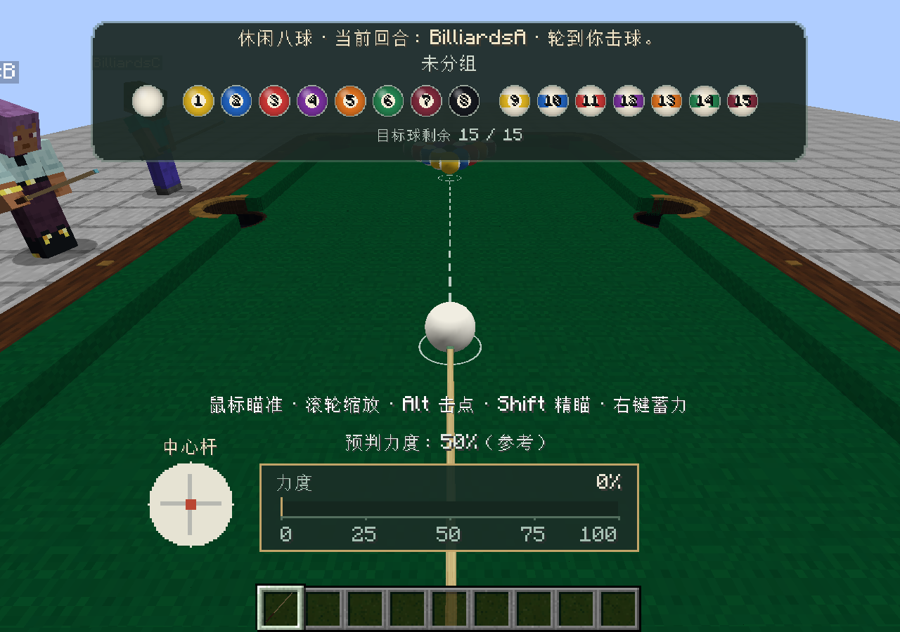
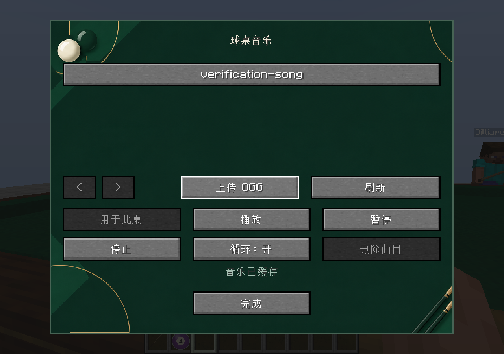

# Monsoon Story: Billiards

[中文说明](README.zh-CN.md)

[Downloads](https://github.com/XiaoZheYa762/monsoonstory-billiards/releases) · [Source](https://github.com/XiaoZheYa762/monsoonstory-billiards) · [Issues](https://github.com/XiaoZheYa762/monsoonstory-billiards/issues)

Play eight-ball and nine-ball pool in your Minecraft world, with three table styles, ordinary cues, practice and multiplayer rooms, spectators, spin, aiming guides, and smooth shot cameras.

Mod ID: `monsoonstory_billiards` · Public version: `1.1.1` · Code license: [Jeefeng Source License v1.0](LICENSE) (source-available)



## Installation

Install the matching release on **both the client and server**. Each build targets its listed Minecraft version and loader; cross-loader play is not supported.

| Build | Required runtime | Required mods |
|---|---|---|
| Fabric 1.20.1 | Java 17 or later | Fabric Loader 0.16.9 or later, Fabric API |
| Forge 1.20.1 | Java 17 | Forge 47.4.28 |
| NeoForge 1.21.1 | Java 21 | NeoForge 21.1.264 or later within 1.21.1 |
| NeoForge 26.1 | Java 25 | NeoForge 26.1.0.19-beta |

The 26.1 artifact targets exactly **26.1**, not 26.1.1 or 26.1.2. Its NeoForge dependency is an upstream beta release.

Better Combat is optional. Without it, ordinary cues retain their vanilla left-click attack and charged right-click thrust. No other Monsoon Story mod is required.

This is an independent public edition. It uses a different namespace from the personal edition; it does not automatically convert old items, tables, or saved games.

## Getting started

Find the items in the **Monsoon Story: Billiards** creative tab, or craft them in survival. Tables need a clear, supported **10 × 6** area. Place a table, right-click it, then choose practice or host a match. A second player can join and ready up.

- Hold a cue and right-click the table to aim. Release that initial click, hold right-click to charge, and release to strike.
- `G`: toggle the guide. `Alt`: change the cue-ball contact point. `R`: center it. `Shift`: precise aim.
- `O`: settings. `V`: change an overview camera position. `Esc`: cancel aiming.
- Eight-ball uses the displayed casual house rules and a called pocket for the black. Nine-ball requires the lowest numbered object ball to be contacted first. Snooker is not included.
- Nearby players can watch and reset a table. Dismantling remains restricted to its owner and operators.

The rack stores six cues and preserves their item data. The floor scoreboard supports scores from 0 to 99; right-click a side to increment, or sneak-right-click to clear. Lamps require suitable ceiling support. Souvenir balls are match rewards, and the temporary cue ball is a server-issued placement tool.

| Crafting output | Materials for one item |
|---|---|
| Green / pink / deep blue table | 3 matching carpets, 4 planks, 1 iron ingot |
| Green / pink / deep blue ordinary cue | 2 sticks, 1 iron nugget, 1 matching carpet |
| Cue rack | 4 sticks, 3 planks |
| Floor scoreboard | 6 planks, 1 red dye, 1 blue dye |
| Green / pink / deep blue lamp | 3 planks, 2 iron ingots, 1 matching carpet, 3 lanterns |

Use blue carpet for the deep blue style. Recipe-book entries show the shaped arrangements. Ordinary cues have 128 durability and a 100% shot-power cap. Playing pool does not consume durability; a successful combat hit does.

## Shared table music

Only operators with permission level 2 or higher can upload and manage music. Open the table's music controls, choose a local **OGG Vorbis** file, upload it, then assign and play it on the table. There is no bundled background song.

Music is shared with nearby listeners. Each listener controls their own volume; the default is 25%. Playback fades in within 8 blocks and out beyond 10 blocks. When several tables are nearby, the client plays one nearby track at a time. Muting music also stops music downloads. A file finishes downloading before playback begins at the current shared position.

Default server limits are 20 MiB per song, ten minutes per song, a 1 GiB library and 1 MiB/s total transfer bandwidth. Server configuration can change these limits. The library lives under the world's `monsoonstory_billiards/music` directory; client downloads are cached locally. Neither location belongs in a source repository or release JAR. Assigned tracks survive a restart, with playback paused until an operator resumes it.

Operators are responsible for having permission to share the files they upload.



## Building from source

The repository contains shared Java code and resources, plus four independent Gradle builds. Use JDK 21 for the older builds, and JDK 25 for NeoForge 26.1. The 1.20.1 builds emit Java 17 bytecode; Gradle downloads additional toolchains when needed.

Windows PowerShell:

```powershell
.\fabric\gradlew.bat -p fabric clean build
.\forge\gradlew.bat -p forge clean build
.\neoforge\gradlew.bat -p neoforge clean build
.\neoforge-26.1\gradlew.bat -p neoforge-26.1 clean build
```

Linux / macOS:

```sh
sh fabric/gradlew -p fabric clean build
sh forge/gradlew -p forge clean build
sh neoforge/gradlew -p neoforge clean build
sh neoforge-26.1/gradlew -p neoforge-26.1 clean build
```

Use the normal installable JAR under each platform's `build/libs`. Files ending in `-sources.jar`, `-verification.jar`, or `-dev.jar` are not the player download. The build includes the committed resources; Python and Blockbench are not required to compile the mod.

`common/` contains the shared physics, rules, prediction, music transport and resources. `fabric/`, `forge/`, `neoforge/` (1.21.1) and `neoforge-26.1/` contain their platform adapters. `art/blockbench/` contains editable model sources. `tools/generate_recipes.py` regenerates survival recipes; `tools/generate_table.py` regenerates shared geometry and the table models from `table_geometry.json`. Both use Python's standard library and are optional for building the committed sources.

## Licenses and release information

Original code uses the custom [Jeefeng Source License v1.0](LICENSE): personal
and non-commercial use is allowed; distributing modified versions requires
complete corresponding source under the same license, attribution and a
clear indication of changes. Commercial use or sale requires prior written
permission. This is a source-available project, not OSI-approved open source.

Original artwork, textures, models and other creative assets use the separate
[Jeefeng Story Asset License](ASSET-LICENSE.md). Personal non-commercial
gameplay is allowed. Reusing or redistributing those assets, including in a
free modpack or modified mod, requires separate written permission. A code
fork can instead replace those assets with appropriately licensed materials.
The listed third-party CC0 recordings and derived sounds retain CC0 terms.

The change begins with 1.1.1; it does not revoke permissions in any copies
previously distributed under MIT. See [NOTICE](NOTICE).

- [Source license](LICENSE)
- [Asset license](ASSET-LICENSE.md)
- [Copyright and licensing transition](NOTICE)
- [Contribution terms](CONTRIBUTING.md)
- [Third-party notices](THIRD_PARTY_NOTICES.md)
- [Development disclosure](AI_USAGE.md)
- [Changelog](CHANGELOG.md)
- [GitHub upload and platform submission](docs/PUBLISHING.zh-CN.md)
- [Verification](docs/VERIFICATION.md)

Report problems through the repository's Issues page and include the Minecraft version, loader, mod version, reproduction steps, and relevant logs with private details removed.
