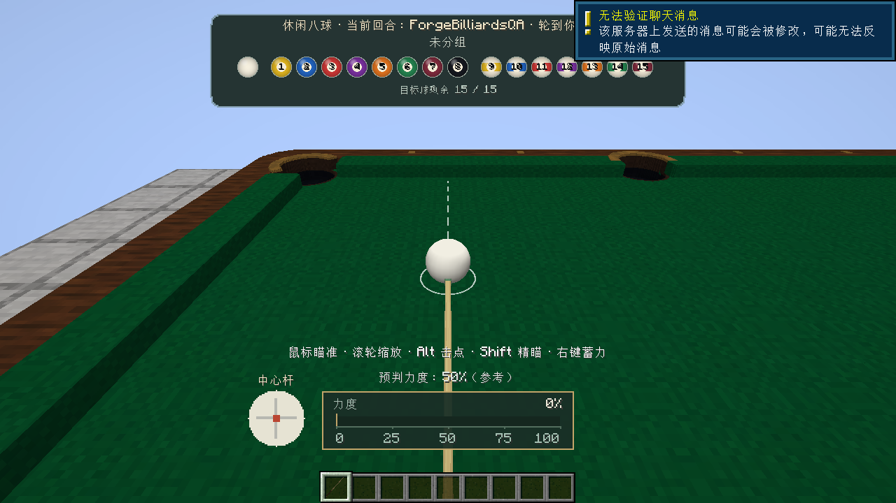
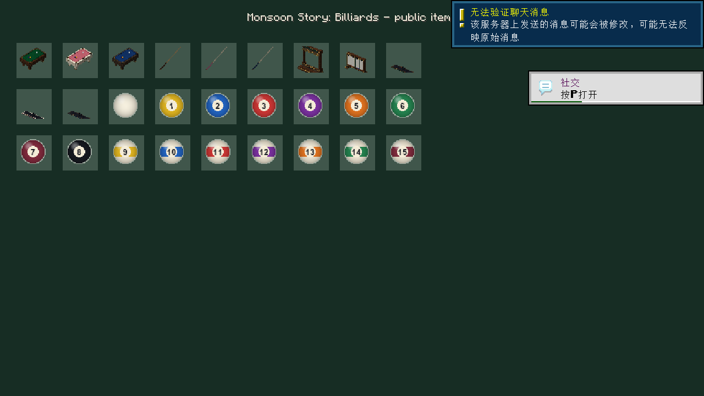
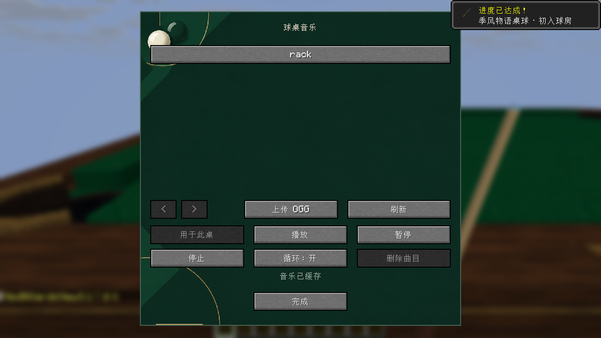

# 1.1.0 review and verification

Date: **2026-10-25**. All test worlds, player identities and music fixtures are isolated from player saves. The older multiplayer and screenshot evidence in [VERIFICATION.md](VERIFICATION.md) applies to 1.0.0 only.

## Reviewed defects

- **Pending table cleanup could starve.** An unloaded table at the beginning of the insertion-ordered cleanup map prevented every later entry from being visited. `Tables.cleanNext` now rotates unfinished entries while preserving the one-table-per-second work limit. Native tests queue an unloaded structure before a loaded one and verify that the loaded structure still disappears.
- **Stopping during music initialization could erase the library index.** The storage worker could finish reading the existing files while its server-thread callback was still pending. `close()` then saved the still-empty in-memory maps. It now saves only after initialization has been applied. The regression closes at that exact boundary, runs the delayed callback, and checks the track index, table assignments and audio bytes remain unchanged.

Both fixes are included in all four builds through the platform adapters and shared music implementation respectively.

## Shared checks

- Music integration: **49 checks**, including the real asynchronous upload/download protocol, file limits, permissions, cancellation, persistence, reconnect races and early shutdown.
- All four targets (Fabric 1.20.1, Forge 1.20.1, NeoForge 1.21.1 and NeoForge 26.1): **85,602 logic checks**, **116,057 prediction checks** and **6,111 power checks** each; these also exercise guide policy, spin and nine-ball rules.
- Native Vorbis decoding: **5 checks** under the Fabric verification runtime.
- Installable JAR validation covers loader identity/version, exact Minecraft versions, bytecode compatibility, JSON, resources and exclusion of verification/runtime data. The 26.1 check also covers all **28 item definitions**, their models and atlas materials, and the **11 converted recipe ingredient definitions**.

## Fabric 1.20.1 and NeoForge 1.21.1

Both 1.1.0 release JARs build successfully. Development GameTest runs passed **17 Fabric public-safety checks** and **43 NeoForge native checks**. The NeoForge fixture also loaded Better Combat 2.4.0, Player Animation 2.0.4 and Cloth Config 15.0.140. These current tests do not repeat the older 1.0.0 multiplayer acceptance run.

## Forge 1.20.1

The new Forge module uses Forge **47.4.28**, Java **17**, native Forge events and a bounded, direction-checked SimpleChannel transport. The installable artifact is reobfuscated; its Mixin refmap and pack metadata are included. Development GameTest passed **43 native checks**.

The final reobfuscated release JAR also passed **44 client checks** using a standard Forge installation, a dedicated server and one real client connected over localhost. The run covered table and furniture models, the item gallery, match/settings screens, aiming, charging, striking, the follow camera and actual music upload/download/playback through the Minecraft sound engine. The report recorded the loaded release JAR and its SHA-256, rather than only testing development classes. Better Combat was absent in this run.



## NeoForge 26.1

The new module targets exactly Minecraft **26.1**, NeoForge **26.1.0.19-beta** and Java **25**. It uses the new registration, persistence, permission, input, GUI and render-state APIs. Resource conversion is generated under `build/`; the committed common resources remain usable by the older games. Static validation against the patched game JAR passed **36 Mixin target checks**.

Native GameTest passed **49 checks**, including all 11 recipes, 18 advancements, table cleanup rotation and furniture inventory/score preservation when replacing its anchor directly. Runtime testing also caught and corrected two migration issues: clientbound payload handlers must be registered explicitly in the new networking API, and duplicating block sprite IDs in the item atlas makes world models select the wrong atlas.

The final release JAR then passed a 14-phase smoke run with a dedicated server and **two real clients** over localhost: **45 operator-client checks** and **3 listener checks**. Both clients loaded the installable JAR, using the NeoForge development launcher for the runtime. The ordinary listener had no operator permissions, received the other player's aim/stroke state, downloaded the assigned music and started playback through the native sound engine. The operator covered model rendering, item previews, menus, settings, aiming, charging, striking, cameras and music management. Better Combat was absent in this run.

Screenshots were inspected for table/ball/cue rendering, item previews, the match menu, aim HUD and music/settings screens; no missing textures were observed in those views. The peer screenshot alone does not establish complete third-person avatar-pose visual correctness. Vanilla offline-session chat/tutorial notices overlap some screenshots.





## Artifact identity and local evidence

The new-port client reports recorded these exact installable artifact hashes:

| Artifact | SHA-256 |
|---|---|
| `monsoonstory_billiards-forge-1.20.1-1.1.0.jar` | `f27f338d1a1ba31c35ab98d2e013e81ebb2b1a45715db58ad0dcf5067a0a0315` |
| `monsoonstory_billiards-neoforge-26.1-1.1.0.jar` | `505c0d9b6706649a7769d7670e9346eb8b9844fdc722247787a84f5d761d2b69` |

Machine-readable reports remain in `forge/build/forge-client-smoke-report.json`, `neoforge-26.1/build/neo-client-smoke-report.json` and `neoforge-26.1/build/neo-listener-smoke-report.json`. Full logs and worlds remain local under their build/run directories and are excluded from the source archive. The copied screenshots above are unmodified output from these release-JAR runs. `dist/1.1.0/SHA256SUMS.txt` identifies all four delivered JARs and the source archive.

## Repeating checks and packaging

From the repository root (use JDK 25 for the 26.1 build):

```powershell
python tools/verify_public.py
pwsh -NoProfile -File tools/test_music.ps1
.\fabric\gradlew.bat -p fabric build verifyLogic verifyPrediction verifyPower verifyVorbis verifyPublicSafety
.\forge\gradlew.bat -p forge build verifyLogic verifyPrediction verifyPower runGameTestServer
.\neoforge\gradlew.bat -p neoforge build verifyLogic verifyPrediction verifyPower runGameTestServer
.\neoforge-26.1\gradlew.bat -p neoforge-26.1 build verifyLogic verifyPrediction verifyPower runGameTestServer
python tools/package_release.py
```

Packaging writes the four installable JARs, an allowlisted source ZIP, source-file manifest and SHA-256 list under `dist/1.1.0/`. Local Java installations, downloaded/decompiled upstream dependencies, game assets, test worlds, client accounts and uploaded music are excluded. No CI run, production-server deployment, arbitrary modpack, shader pack, long-running load or public-network latency coverage is implied by local verification. Optional Better Combat coverage for 1.1.0 is limited to the NeoForge 1.21.1 native fixture described above.
